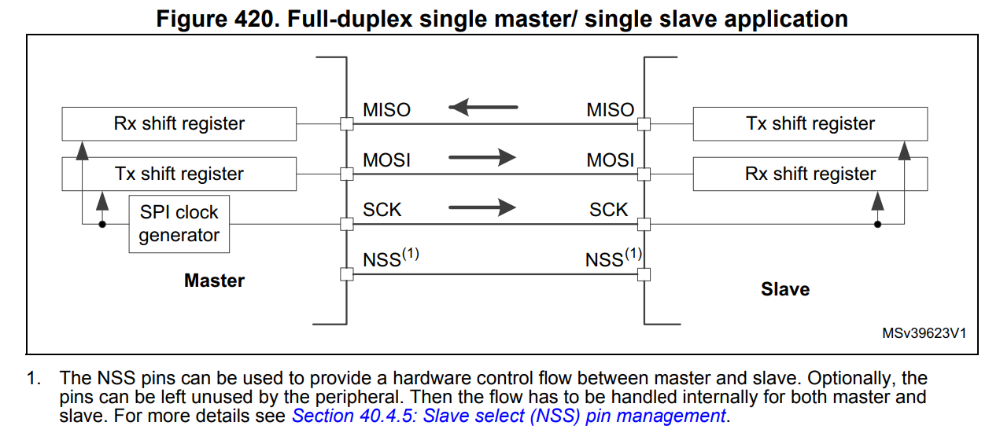
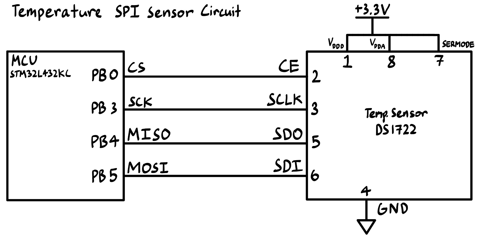
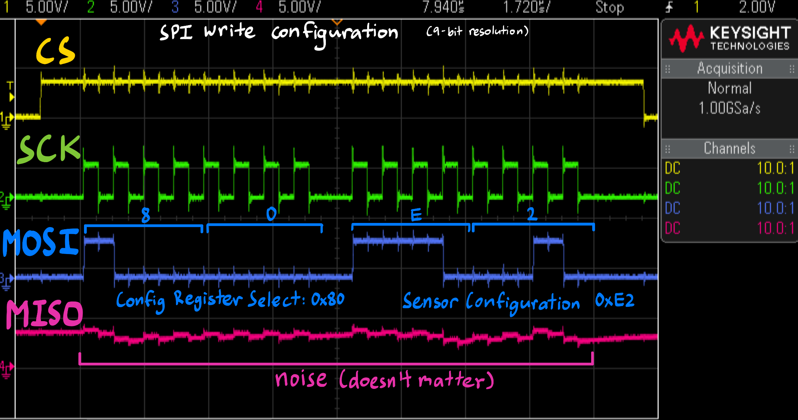
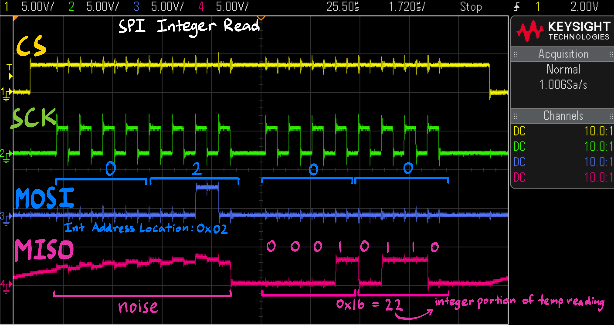
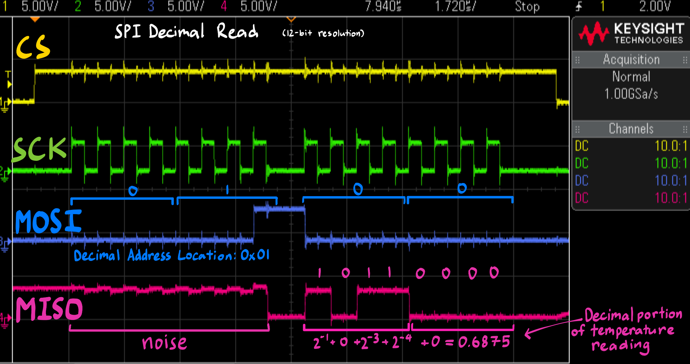
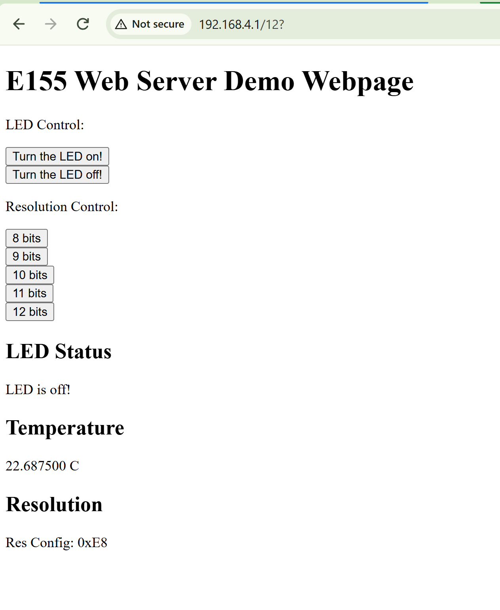
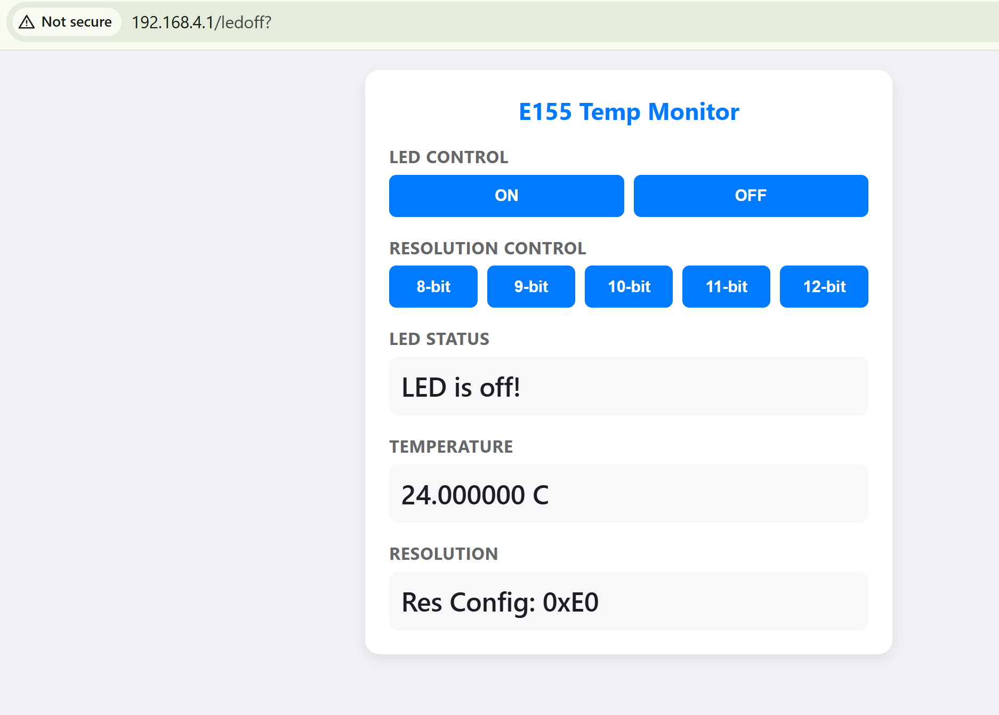

## Introduction
In this project, I built an internet-accessible device to control an onboard LED and measure ambient temperature. 

In summary, I...

* Wrote my own SPI device driver using Common Microcontroller Software Interface Standard (CMSIS) device templates.

* Interfaced with a temperature sensor module over an SPI link.

* Interfaced with an ESP8266 wifi module over UART link.

* Wrote a simple HTML page to control resolution and display data from the temperature sensor.

* Used the oscilloscope to capture the serial communication protocols.

## Design and Implementation Methodology

I chose to configure SPI for full duplex communication between the MCU (Master/controller) and the temperature sensor module (Slave/peripheral). 

::: {.callout-note collapse="true"}
## SPI Full Duplex Communication
{#fig-SPI}
Source: STM32L4xxxx Reference Manual Figure 420. on page 1306.

I used a GPIO pin to toggle control CS (chip select) instead of NSS.
:::

The baud rate for USART between the MCU and Wifi module was set at 1.25 MHz, so the SPI baud rate was also configured to be set to 1.25 MHz. Clock phase was set to 1 to match the temperature sensor, and polarity was set to 0.

For SPI communication with the temperature sensor, a write transaction must occur first to communicate the address of the register being accessed. For the configuration write transaction, the MCU first sends the address of the configuration register address to the temperature sensor module (MISO), and then sends the configuration that is to be written into the register (MISO). For a read transaction, the MCU first sends the address of the measurement register address (either the decimal register or the integers register) (MISO) and then in the next 8-bit frame the temperature sensor responds with the data stored there (MOSI). To read the whole temperature measurement, I need to read twice: one read for integers, and another for decimals. These combined give the temperature measurement output displayed on the webpage. This communication can be seen in the oscilloscope traces below (@fig-write, @fig-IntRead, @fig-DecRead).

## Technical Documentation:

The source code for the project can be found in the associated [Github repository](https://github.com/jesli12/e155-lab6).

### Schematic

The schematic below shows the connections between the MCU and the external temperature sensor module.

::: {.callout-note collapse="true"}
## Schematic
{#fig-schematic}
Author: Jessica Li 
Date: 10/20/2026

Note: The ESP8266 wifi module was connected directly to the base developmenet PCB, and as such is viewed as an internal connection. These schematics only show external connections.
:::

### Captured Signal Data for SPI

The oscilloscope traces below verify the serial communcation protocols between the MCU and the temperature sensor module. Note that a logic analyzer was unavailable to me at the time, so oscilloscope traces were used in replacement.

The following traces show a write transation to configure the temperature sensor, and a read temperature transaction. The data signals probed are: CS, SCK, MISO, MOSI. Note that clock phase was set to 1 and clock polarity was set to 0.

::: {.callout-note collapse="true"}
## SPI Write to Configuration
{#fig-write}
:::

::: {.callout-note collapse="true"}
## SPI Read Temperature Transaction
{#fig-IntRead}

{#fig-DecRead}

This read represents a temperature measurement of 22.6875C.
:::

::: {.callout-note collapse="true"}
## Example Webpage Output
This screenshot shows the output of the previous read temperature transaction
{#fig-webpage}
:::


## Conclusion

All project [specifications](https://hmc-e155.github.io/lab/lab6/specs.html) were met.

This small simple IoT device was successfully able to interface a temperature sensor module over an SPI link, and between the MCU (STM32L432KC) and an ESP8266 module over an UART link. I was able to write and use my own driver to enable SPI communication for interfacing with the temperature sensor.

The temperature measured was displayed on a webpage and refreshed with every user request. It was able to correctly read temperatures across the sensor's -10C to 30C range. Through the webpage, the user was also able to control the measurement resolution of the temperature sensor module. 

I was also able to verify the serial communication protocols and capture signal data with an oscilloscope to ensure data was passed as expected. (This was helpful during the debugging process!)

I spent roughly a total of 15 hours working on this lab. Further improvements could be made to the webpage for aesthetics and general user-friendliness. I would also want to change the displayed significant figures of the temperature measurement to reflect the resolution selected, without any extra zeros at the end.

## AI Prototype Summary

To explore the capability and usage of AI for generating frontend web code vs. low-level embedded C, the following prompts were entered into Gemini Pro after the project was completed:

::: {.callout-note title="LLM Prompt 1: Frontend Web Code" collapse="true"}
"I’m making a web portal to interface with a temperature sensor. Create a HTML page that looks good and is intuitive to show the temperature, control an LED, and change the precision of the readout."

Output:
{#fig-ai}
:::

It gave me a very clean and nicely design webpage, but the code was very long and more complex than it needed to be in my opinion. After some feedback from me, I ended up with Gemini Pro generating me the webpage seen in the callout above. It is relatively simple but still looks more aesthetic and intuitive than the bare-bones html I originally had. One downside: even after giving Gemini Pro my original html webpage code, it still couldnt give me working buttons for resolution control. There were buttons on the webpage, but the ones specifically for measurement resolution control were unresponsive and did not send requests. The LED control ones worked fine.

::: {.callout-note title="LLM Prompt 2: Low-level Embedded C" collapse="true"}
"Write me a C function to carry out a SPI transaction to retrieve a temperature reading from a DS1722 sensor. Make use of CMSIS libraries for the STM32L432KC."
:::

With this prompt alone, Gemini was able to generate roughly the right steps and structure. However, this can actually make it harder to debug, as certain things may look right but are actually configured wrong or a variable could hold an incorrect value. 

This first generated code wasn't able to run due to may different errors. Examples include the incorrect configuration of the MCU STM32's SPI such that it was incompatible with the DS1722 temperature sensor, pin numbers that do not have SPI as their alternate functions, and more. 

I attempted to catch and respond with these errors, but next time I should also upload the relevant datasheets and see how the LLM does without additional prompting. The final output code can be found below.

::: {.callout-note title="LLM Output" collapse="true"}
  ```
  #include "stm32l4xx_ll_bus.h"
  #include "stm32l4xx_ll_gpio.h"
  #include "stm32l4xx_ll_spi.h"

  // Hardware Pin Definitions for GPIOB
  #define DS1722_CS_PORT          GPIOB
  #define DS1722_CS_PIN           LL_GPIO_PIN_0

  #define DS1722_SPI_PORT         GPIOB
  #define DS1722_SCK_PIN          LL_GPIO_PIN_3
  #define DS1722_MISO_PIN         LL_GPIO_PIN_4
  #define DS1722_MOSI_PIN         LL_GPIO_PIN_5

  // Software CS Control (DS1722 requires Active-HIGH)
  #define DS1722_CS_HIGH()        LL_GPIO_SetOutputPin(DS1722_CS_PORT, DS1722_CS_PIN)
  #define DS1722_CS_LOW()         LL_GPIO_ResetOutputPin(DS1722_CS_PORT, DS1722_CS_PIN)

  // DS1722 Memory Addresses
  #define DS1722_READ_INT_ADDR    0x01  // Integer byte address
  #define DS1722_READ_DEC_ADDR    0x02  // Fractional byte address

  /**
  * @brief  Transceives a single 8-bit byte over SPI1.
  * @param  txData Byte to transmit
  * @retval Received byte
  */
  static uint8_t SPI1_TransceiveByte(uint8_t txData)
  {
      while (!LL_SPI_IsActiveFlag_TXE(SPI1));
      LL_SPI_TransmitData8(SPI1, txData);

      while (!LL_SPI_IsActiveFlag_RXNE(SPI1));
      return LL_SPI_ReceiveData8(SPI1);
  }

  /**
  * @brief  Reads a register value from the DS1722 over SPI.
  * @param  regAddr Target register memory address
  * @retval Byte read from device
  */
  static uint8_t DS1722_ReadRegister(uint8_t regAddr)
  {
      uint8_t rxData = 0;

      // 1. Assert CS HIGH (Active-HIGH for DS1722)
      DS1722_CS_HIGH();

      // 2. Write address to read
      SPI1_TransceiveByte(regAddr);

      // 3. Write dummy byte (0x00) to clock out register data
      rxData = SPI1_TransceiveByte(0x00);

      // 4. De-assert CS LOW
      DS1722_CS_LOW();

      return rxData;
  }

  /**
  * @brief  Retrieves temperature reading from DS1722 in °C.
  * @retval Temperature in Degrees Celsius
  */
  float DS1722_ReadTemperature(void)
  {
      int8_t temp_int = (int8_t)DS1722_ReadRegister(DS1722_READ_INT_ADDR);
      uint8_t temp_dec = DS1722_ReadRegister(DS1722_READ_DEC_ADDR);

      // LSB represents 1/256th °C step (0.00390625)
      float temp_fraction = (float)temp_dec / 256.0f;

      if (temp_int < 0) {
          return (float)temp_int - temp_fraction;
      } else {
          return (float)temp_int + temp_fraction;
      }
  }
  ```
  ```
  void DS1722_SPI1_Init(void)
  {
    // 1. Enable Clocks for GPIOB and SPI1
    LL_AHB2_GRP1_EnableClock(LL_AHB2_GRP1_PERIPH_GPIOB);
    LL_APB2_GRP1_EnableClock(LL_APB2_GRP1_PERIPH_SPI1);

    // 2. Configure PB0 as CS Output (Active-HIGH)
    LL_GPIO_SetPinMode(GPIOB, LL_GPIO_PIN_0, LL_GPIO_MODE_OUTPUT);
    LL_GPIO_SetPinOutputType(GPIOB, LL_GPIO_PIN_0, LL_GPIO_OUTPUT_PUSHPULL);
    LL_GPIO_SetPinSpeed(GPIOB, LL_GPIO_PIN_0, LL_GPIO_SPEED_FREQ_HIGH);
    LL_GPIO_ResetOutputPin(GPIOB, LL_GPIO_PIN_0); // Default CS LOW (Idle)

    // 3. Configure PB3 (SCK), PB4 (MISO), PB5 (MOSI) as Alternate Function AF5
    LL_GPIO_SetPinMode(GPIOB, LL_GPIO_PIN_3, LL_GPIO_MODE_ALTERNATE);
    LL_GPIO_SetAFPin_0_7(GPIOB, LL_GPIO_PIN_3, LL_GPIO_AF_5);
    LL_GPIO_SetPinSpeed(GPIOB, LL_GPIO_PIN_3, LL_GPIO_SPEED_FREQ_HIGH);

    LL_GPIO_SetPinMode(GPIOB, LL_GPIO_PIN_4, LL_GPIO_MODE_ALTERNATE);
    LL_GPIO_SetAFPin_0_7(GPIOB, LL_GPIO_PIN_4, LL_GPIO_AF_5);
    LL_GPIO_SetPinSpeed(GPIOB, LL_GPIO_PIN_4, LL_GPIO_SPEED_FREQ_HIGH);

    LL_GPIO_SetPinMode(GPIOB, LL_GPIO_PIN_5, LL_GPIO_MODE_ALTERNATE);
    LL_GPIO_SetAFPin_0_7(GPIOB, LL_GPIO_PIN_5, LL_GPIO_AF_5);
    LL_GPIO_SetPinSpeed(GPIOB, LL_GPIO_PIN_5, LL_GPIO_SPEED_FREQ_HIGH);

    // 4. Configure SPI1 Peripheral Settings
    // Prescaler DIV64 yields 1.25 MHz from an 80 MHz APB2 clock source
    LL_SPI_SetBaudRatePrescaler(SPI1, LL_SPI_BAUDRATEPRESCALER_DIV64);
    LL_SPI_SetClockPolarity(SPI1, LL_SPI_POLARITY_LOW);   // CPOL = 0
    LL_SPI_SetClockPhase(SPI1, LL_SPI_PHASE_2EDGE);        // CPHA = 1
    LL_SPI_SetTransferDirection(SPI1, LL_SPI_FULL_DUPLEX);
    LL_SPI_SetDataWidth(SPI1, LL_SPI_DATAWIDTH_8BIT);
    LL_SPI_SetNSSMode(SPI1, LL_SPI_NSS_SOFT);              // Software CS Control
    LL_SPI_SetMode(SPI1, LL_SPI_MODE_MASTER);
    LL_SPI_SetTransferBitOrder(SPI1, LL_SPI_MSB_FIRST);

    // 5. STM32L4 FIFO Threshold (Required for correct 8-bit SPI transfers)
    LL_SPI_SetRxFIFOThreshold(SPI1, LL_SPI_RX_FIFO_TH_QUARTER);

    // 6. Enable SPI1
    LL_SPI_Enable(SPI1);
  }
  ```
:::

