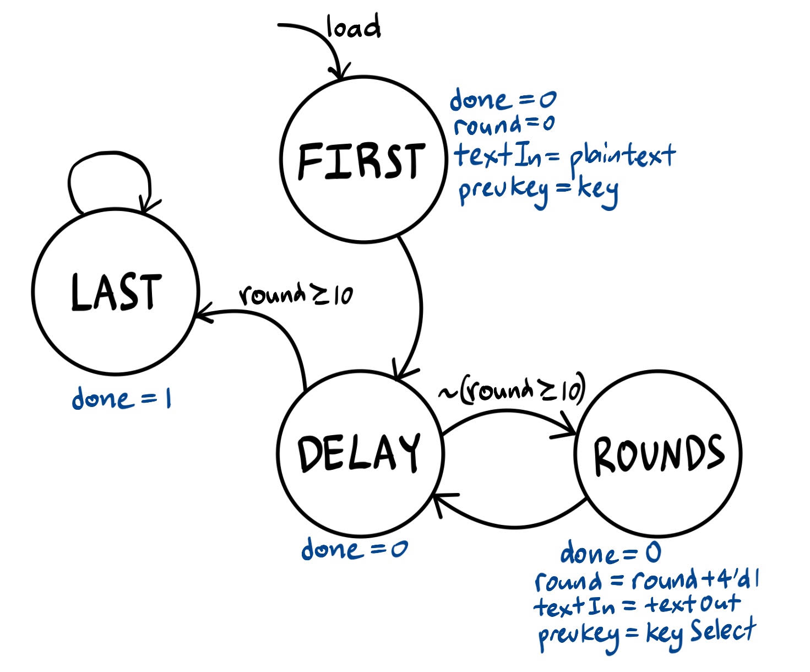
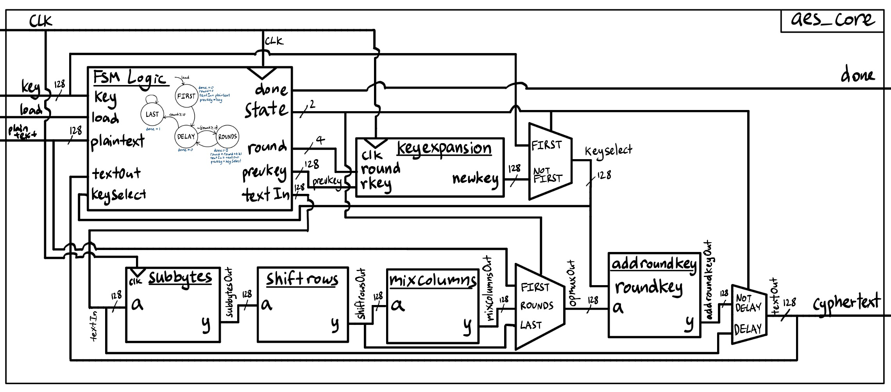
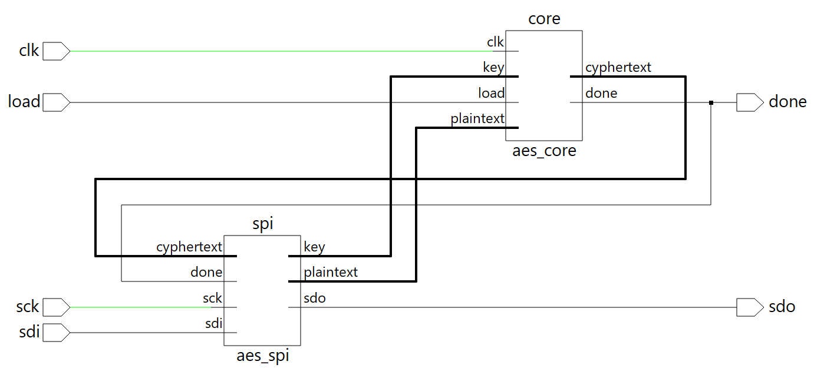
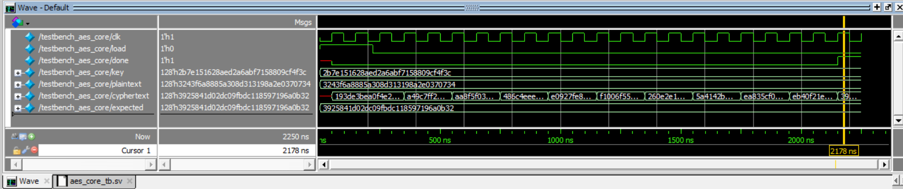
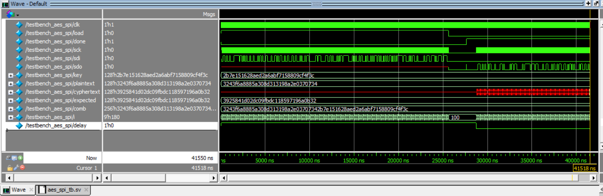
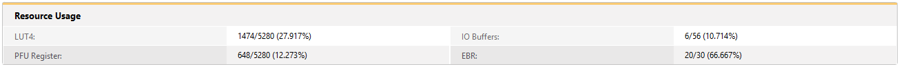

## Introduction
In this project, I construct a hardware accelerator on the FPGA to perform 128-bit AES encryption. 
A microprocessor sends a plaintext message and key to the FPGA for it to encode, and the cyphertext output has been verified for correctness.

In summary, I...

* Learned to read and implement a complex specification (AES encryption)

* Built a nontrivial system on an FPGA that requires thoughtful architecture to fit on the chip

* Implemented an SPI interface to communicate between the FPGA and microprocessor

## Design and Implementation Methodology

In order for the design to fit onto the FPGA, the design reused hardware using a controller and datapath structure. The 128-bit AES encryption logic is 
too large to implement all computation rounds as a single large block of combinational logic. Therefore, computations were performed sequentially in rounds that reused hardware. 

The datapath contained the following logic blocks to be reused in round computations:

1. SubBytes
2. ShiftRows
3. MixColumns
4. KeyExpansion 
5. AddRoundKey

The datapath is illustrated in the core block diagram in @fig-aes_block.

The finite state machine that controls the datapath per round of computations is shown in @fig-fsm.

::: {.callout-note collapse="true"}
## AES Finite State Machine
{#fig-fsm}

Each state controls signals in the datapath such that only the operations needed in the round are connected and used.
::: 

## Technical Documentation
The source code for the project can be found in the associated [Github repository](https://github.com/jesli12/e155-lab7).

### Block Diagram
The block diagram in @fig-aes_block shows the overall architecture of the AES FPGA design. 

::: {.callout-note collapse="true"}
## FPGA AES Design Block Diagram
{#fig-aes_block}

FSM logic was described in the previous section.
::: 

The block diagram in @fig-top_block shows the architecture of the top level, including the SPI interface module.

::: {.callout-note collapse="true"}
## Top Level Block Diagram
{#fig-top_block}
::: 

## Result and Discussion

### Testbench Simulation
The design does successfully passes the aes_core module testbench (```aes_core_tb```) and the full FPGA system testbench (```aes_spi_tb```) that includes the SPI interface.

::: {.callout-note collapse="true"}
## aes_core_tb
{#fig-waveform}

The final output of ```cyphertext``` matches the ```expected``` value, thus this test passes successfully!
:::


::: {.callout-note collapse="true"}
## aes_spi_tb
{#fig-waveform_spi}

The final output of ```cyphertext``` matches the ``expected`` value, thus this test passes successfully!
:::

All testbenches pass successfully, DUT behaves as expected.

::: {.callout-note collapse="true"}
## Radiant Synthesis Resource Report
{#fig-resource}

Radiant's report on resource usage of my implementation, showing that the design fits on the FPGA.
:::


## Conclusion

The design was able to successfully produce 128-bit cypertexts from the plaintext and key inputs, and met lab proficiency specifications. 

While I was able to demonstrate correct behavior in test simulations, I was unable to get the design to work on hardware (uploaded to the FPGA and MCU). Given more time, I 
would debug the issues in hardware such that it did work. It would also be important to separate the FSM controller logic in aes_core to actually be its own module, and have the datapath in a 
separate module as well for easier unit testing. It would've also been interesting to implement a inverse cipher to reverse encryption as well. I could've also been 
more efficient with hardware usage in multiple areas, most pointedly in my 16 sbox instantiations for subbytes, which could be reduced using sequential logic to allow for the reuse of that 
hardware at the cost of more computation time.

I spent roughly 25 hours in total on this lab.

## AI Prototype Summary

Does withholding a specification from Gemini AI Pro, which simulates withholding confidential information, change the quality of the HDL the LLM generates?

To explore the capability and usage of AI for generating HDL, the following prompts were entered into Gemini AI Pro after the project was completed:

::: {.callout-note title="LLM Prompt 1: Attached AES Standards PDF" collapse="true"}
"Write SystemVerilog HDL to implement the KeyExpansion logic described in the FIPS-197 uploaded document. The module should be purely combinational, using the previous key and current round number to calculate the next key. Assume other required modules (SubWord and RotWord) are already implemented."
:::


::: {.callout-note title="LLM Prompt 2: Avoid Existing Knowledge of AES" collapse="true"}
"Write SystemVerilog HDL to implement the following logic:

```i = 0

while i < Nk do

    w[i] <- key[4*i..4*i+3]

    i <- i+1

end while

while i <= 4 * Nr + 3 do

    temp <- w[i-1]

    if i mod Nk = 0 then

        temp <- module1(module2(temp)) (+) Rcon[i/Nk]

    else if Nk > 6 and i mod Nk = 4 then

        temp <- module1(temp)

    end if

    w[i] <- w[i-Nk] (+) temp

    i <- i + 1

end while

return w```


Assume module1 and module2 are existing modules that can be instantiated. (+) refers to XOR. Unwrap the loop in the provided pseudo code so it uses the previous iterations output to generate the new iteration.

Do not use any existing knowledge of the AES specifications in your answer."
:::

For the first prompt, Gemini was able to generate cleanly organized and well commented HDL that had some resemblance to the structure I implemented. However, 
my code processes all 128 bits (4 words) at once, but Gemini's generated keyexpansion module takes and processes 32 bit words at a time. These two modules can essentially 
be equivalent with some added control logic with Gemini's module to support the full 128 bits. Of course, it is important to have sbox_sync in order to reuse the sbox hardware sequentially, 
since a purely combinational sbox is quite hardware intensive due to the necessary look-up tables (LUTs) per instantiation.

As for the second prompt, it was interesting that the Gemini output code was substantially harder to read, especially as it generated code using for loops (```gen_var``` syntax), which is something 
I haven't seen very often before. The code structure has lost the clean and intuitive structure that prompt 1 had generated.
